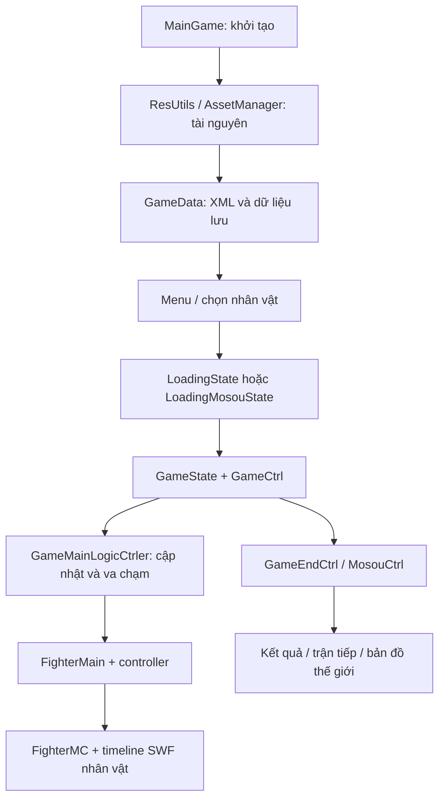

# Phân tích Bleach vs Naruto — bản SWF hiện có

Phạm vi: phân tích tĩnh mã AS3 và cấu hình trong workspace. Chưa chạy game để kiểm chứng cảm giác điều khiển, độ cân bằng, lỗi runtime hoặc mọi đường đi của từng chiêu. Không thay đổi SWF hoặc mã gameplay.

## 1. Nhận diện bản game

`MainGame.as` khai báo VERSION="V3.5B", VERSION_DATE="2021.03.24". Đây là thông tin nội bộ của binary; không suy ra lịch phát hành công khai hay nguồn gốc bản tải. Nền tảng Flash/ActionScript 3, kích thước logic 800×600. GameConfig đặt FPS_GAME=60, FPS_UI=30 và FPS_ANIMATE=30; SPEED_PLUS_DEFAULT=30/FPS_GAME.

Game là đối kháng 2D với nhân vật, biến hình và trợ chiến thuộc nhiều nhóm. fighter.xml còn có Kenshin và các enemy phụ, nên tên game không mô tả toàn bộ nội dung.

## 2. Các chế độ được khai báo

Nguồn: `extracted/scripts/net/play5d/game/bvn/data/GameMode.as`.

| ID | Hằng số | Ý nghĩa theo mã |
|---|---|---|
| 10 / 20 | TEAM_ACRADE / SINGLE_ACRADE | Arcade đội / đơn |
| 11 / 21 | TEAM_VS_PEOPLE / SINGLE_VS_PEOPLE | Hai người chơi, đội / đơn |
| 12 / 22 | TEAM_VS_CPU / SINGLE_VS_CPU | Đấu CPU, đội / đơn |
| 30 | SURVIVOR | Sinh tồn |
| 40 | TRAINING | Luyện tập |
| 100 | MOSOU_ACRADE | Mosou, có hệ thống nhiệm vụ và tiến triển |

Việc có hằng số và nhánh xử lý chưa chứng minh mọi chế độ đều xuất hiện trong menu của bản chạy hiện tại. Hai người dùng hai bộ phím cục bộ; phần đã đọc chưa cho thấy cơ chế đấu mạng.

## 3. Dữ liệu nhân vật và bản đồ

Phân tích XML có loại bỏ comment trong bộ nhớ, không sửa file:

- fighter.xml: 79 định nghĩa, gồm 3 lựa chọn random và 11 enemy có tiền tố xb_. 65 định nghĩa còn lại gồm các dạng biến hình và biến thể cũ; không đồng nghĩa 65 nhân vật độc lập hoặc tất cả đều chọn được.
- assist.xml: 40 định nghĩa, gồm 37 trợ chiến và 3 lựa chọn random.
- map.xml: 20 mục, gồm 19 mục tham chiếu SWF sân đấu và một mục random.
- select.xml: chứa cả cấu hình lựa chọn; không đếm mọi thẻ item thành nhân vật.

FighterVO đọc ID, tên, comic_type, đường dẫn SWF, startFrame, chân dung, lời thoại và BGM. Ví dụ ichigo và ichigo_bankai dùng chung fighter/ichigo.swf nhưng startFrame lần lượt 1 và 2. Nhân vật và dạng nhân vật được ánh xạ bằng dữ liệu và timeline, không phải mỗi dạng bắt buộc có một SWF riêng.

GameData.loadConfig nạp config/select.xml; salect.xml tồn tại nhưng không được dùng trong chuỗi nạp mặc định đã đọc. Tránh sửa nhầm file có tên gần giống.

## 4. Kiến trúc và luồng chạy

MainGame quản lý chuyển màn hình qua KyoStageCtrl. GameRender đăng ký enterFrame trên Stage và gọi các callback. GameCtrl quản lý trận, pause, bắt đầu/kết thúc, training và Mosou. GameState chứa scene; GameCamera và MapMain đảm nhiệm camera/sân đấu. Nhiều dịch vụ dùng singleton `.I`, nên khi theo dõi dữ liệu cần chú ý trạng thái dùng chung giữa các màn hình.

GameCtrl tách nhịp animation khỏi nhịp game: ở mặc định 60 FPS, animation được cập nhật khoảng 30 lần/giây. GameMainLogicCtrler kiểm tra đòn đánh theo cờ renderAnimate, còn va chạm thân thể được xử lý trong vòng cập nhật chính. Khi thay đổi FPS, phải kiểm tra timer, tốc độ, hồi tài nguyên và cửa sổ combo cùng nhau; không thể mặc định mọi bộ đếm đều dùng cùng một nhịp.

## 5. Chiến đấu và sát thương

Chuỗi chính: FighterKeyCtrl hoặc FighterAICtrl → FighterActionLogic → FighterMcCtrler/FighterMC → HitVO → GameMainLogicCtrler.checkHit → beHit/hit → xử lý hurt/defense → BaseGameSprite.loseHp.

FighterMC có bộ cache vùng `body`, `hit`, `hit_check`. GameMainLogicCtrler lấy vùng chữ nhật hiện tại, tính intersection, rồi gọi xử lý trúng đòn ở hai phía. Đây là va chạm vùng hình học; không có bằng chứng phần này dùng va chạm từng pixel.

HitVO chứa power, powerAdd, powerRate, hitType, isBreakDef, hitx/hity, hurtTime và hurtType. Sát thương cơ sở:

`D = int(power × (1 + powerAdd / 100) × powerRate)`

Trong các nhánh đã đọc ở FighterMcCtrler:

- Trúng bình thường: truyền D vào loseHp.
- Chặn đòn: truyền 0.05 × D, kèm tiêu hao energy và xử lý phá thủ.
- Steel body: truyền 0.65 × D.
- Super steel body: truyền 0.30 × D.

Đây chưa phải lượng HP mất cuối cùng. BaseGameSprite.loseHp tiếp tục xử lý:

`r = clamp(2 - defenseRate, 0.1, 1)`

`HP mất = max(0, sát thương đầu vào × r - defense)`

Nếu isAllowLoseHP=false thì không trừ HP. Ví dụ D=100, defenseRate=1, defense=0: nhánh thường mất 100; chặn thường mất 5. Điều kiện hướng đỡ, loại đòn, phá thủ, trạng thái và các nhánh đặc biệt vẫn ảnh hưởng kết quả.

GameLogic.resetFighterHP sử dụng customHpMax nếu có, nếu không dùng 1000; nhân thêm cấu hình fighterHP và hệ số nhiệm vụ. Vì vậy sửa hằng số FIGHTER_HP_MAX chưa chắc thay đổi mọi nơi sử dụng HP.

## 6. Tài nguyên chiến đấu

FighterMain mặc định: qi=0, qiMax=300; energy=100, energyMax=100; fzqi=100 với giới hạn 100. HP cơ sở ở BaseGameSprite mặc định 1000.

- HP: sự sống, kiểm tra chết tại hp<=0.
- Qi: được tiêu qua useQi, tích lũy trong quá trình chiến đấu; liên quan kiểm tra chiêu bisha/đặc biệt.
- Energy: hồi theo trạng thái, bị dùng bởi các hành động và phòng thủ. renderEnergy có mức hồi 2 bình thường, 0.8 khi phòng thủ, 1.1 khi tấn công; overload hồi 0.6 và thoát overload khi vượt 30.
- Fzqi: thanh trợ chiến, hồi 0.2 mỗi lần renderFzQi được gọi.

Các số hồi trên là giá trị mỗi lần cập nhật hàm, không phải mỗi giây. useEnergy đặt thời gian chờ hồi bằng 0.8×30=24 lượt đếm. Cần theo dõi nơi gọi trước khi quy đổi chính xác sang thời gian thực.

## 7. Điều khiển

ConfigVO + KeyConfigVO ánh xạ mặc định:

| Hành động | P1 | P2 |
|---|---|---|
| Lên / xuống / trái / phải | W / S / A / D | Phím mũi tên |
| Attack | J | Numpad 1 |
| Jump | K | Numpad 2 |
| Dash | L | Numpad 3 |
| Skill | U | Numpad 4 |
| SuperKill | I | Numpad 5 |
| Beckons | O | Numpad 6 |

Đây là ánh xạ hành động trong mã; tổ hợp hướng/phím và trạng thái trên không quyết định biến thể chiêu. FighterActionLogic có attackAIR, skill1/2/AIR, zhao1/2/3, catch1/2, bisha/UP/SUPER/AIR, ghostStep và các nhánh biến hình. Cấu hình có thể ghi đè phím mặc định.

## 8. AI

FighterAILogic và FighterAILogicBase triển khai quyết định theo luật và xác suất. getAIResult sinh Math.random()*10 rồi so với ngưỡng phụ thuộc AILevel. AI xem trạng thái đối thủ, khoảng cách, vùng đánh, tài nguyên, khả năng thực hiện chiêu và ưu tiên hành động. Có các cập nhật riêng cho di chuyển, nhảy, dash, phòng thủ, chiêu, trợ chiến và ghost step.

Không thấy cơ chế học máy trong các lớp AI đã kiểm tra. Độ khó không chỉ là một hệ số sát thương: nhiều bảng xác suất thay đổi hành vi. EnemyFighterAICtrl và EnemyBossAICtrl tồn tại riêng cho enemy/boss.

## 9. Mosou và lưu dữ liệu

Mosou có world map, nhiệm vụ, wave/enemy/boss, tiền và cấp độ. MosouFighterLogic lấy HP/Qi/Energy và tăng sát thương từ dữ liệu người chơi. Một số hành động có ngưỡng cấp: skillAIR=2, skill1=3, skill2=5, super bisha=6, Bankai=10, ghost step=12. Không suy ra mọi nhân vật có cùng bộ chiêu chỉ từ các ngưỡng này.

GameData.saveData thông qua GameInterface. Bản GameInterfaceManager dùng KyoSharedObject với khóa `bvn3_save`. Cấu hình và dữ liệu Mosou được lưu qua lớp trừu tượng này; không phải thay đổi XML sẽ tự động xóa/ghi đè save hiện có.

## 10. Vì sao SWF chính có ít ảnh nhưng game có nhiều nội dung?

SWF chính chứa một ZIP asset lớn và 12 SWF nhúng trực tiếp. ZIP có 122 SWF bổ sung, cùng hình chân dung, nhạc, âm thanh và XML/JSON. ZipAssetLoader đọc XML/JSON/SWF/ảnh/âm thanh qua ZipCtrler; tên đường dẫn được chuẩn hóa với tiền tố assets/.

Các SWF nhân vật chứa MovieClip, addFrameScript và callback đến `$mc_ctrler`/`$effect_ctrler`. Ví dụ đã đọc `scripts/embedded/084_naruto/naruto_fla/鸣人全动作_2.as`. Animation không chỉ là hình ảnh: callback timeline điều khiển hành động và hiệu ứng. Một bản port bằng sprite sheet cần tái dựng cả sự kiện frame, hitbox và hành vi chiêu.

## 11. Chất lượng mã decompile và điểm cần xác minh

575/1357 file .as chứa dấu `§§` của mã không được tái dựng thành AS3 thông thường. Danh sách: decompiler_artifact_files.txt. Đây là chỉ báo kỹ thuật, không đồng nghĩa tất cả các file đó đều hỏng hay không thể đọc. Một số đoạn còn có invalid_utf8, biểu thức bất thường và chuỗi toán học khó hiểu; nguyên nhân có thể là obfuscation hoặc giới hạn decompiler, chưa kết luận toàn bộ.

map.xml có comment chứa chuỗi `--`, khiến parser XML chuẩn Python báo lỗi ở dòng 55. Đã đếm cấu hình bằng cách bỏ comment trong bộ nhớ; file gốc được giữ nguyên. Chưa kiểm chứng cách parser E4X của Flash xử lý comment đó lúc chạy.

GameCtrl.renderGameTime dùng `++_renderTimeFrame > 30`, tức 31 lượt renderGameTime trước khi giảm timer. Đây là chi tiết đáng kiểm chứng khi thay đổi nhịp game; chưa gọi là bug runtime.

Chưa có căn cứ để xếp hạng nhân vật mạnh/yếu, kết luận độ cân bằng, xác nhận tất cả chế độ chạy ổn hoặc coi mã export là project Flash có thể build lại.

## 12. Điểm vào cho phân tích/mod tiếp theo

| Mục tiêu | Tệp/khu vực cần đọc |
|---|---|
| HP và phòng thủ cuối cùng | interfaces/BaseGameSprite.as; ctrl/GameLogic.as |
| Sát thương chiêu | fighter/models/HitVO.as; FighterHitModel.as; script timeline nhân vật |
| Chặn, trúng đòn, stun, knockback | fighter/ctrler/FighterMcCtrler.as |
| Energy, Qi và trợ chiến | fighter/FighterMain.as; controller và event chiến đấu |
| AI | fighter/ctrler/ai/; FighterAICtrl; Enemy*Ctrl |
| Nhân vật/dạng/chân dung | assets/config/fighter.xml; select.xml; fighter SWF |
| Phím và combo | data/ConfigVO.as; input/; FighterKeyCtrl; FighterActionLogic |
| Round/timer/kết quả | ctrl/game_ctrls/GameCtrl.as; GameEndCtrl.as |
| Mosou và tiến triển | data/mosou/; ctrl/mosou_ctrls/; assets/config/mosou/ |

Các đường dẫn AS3 trong bảng tính từ extracted/scripts/net/play5d/game/bvn/. Tài nguyên assets tính từ extracted/binary/unpacked/.

Phân tích tiếp một nhân vật nên đi từ ID trong fighter.xml → fileUrl và startFrame → timeline AS3 ở scripts/embedded → định nghĩa HitVO và frame kích hoạt → kiểm tra engine xử lý trúng đòn. Đây là cách nối một chiêu cụ thể với sát thương, thời điểm đánh và phản ứng của đối thủ.
